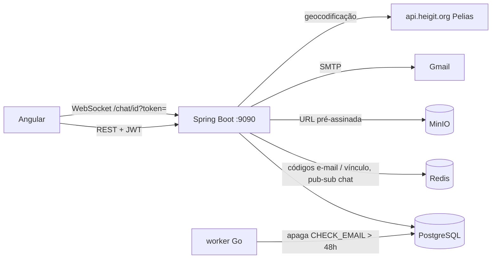
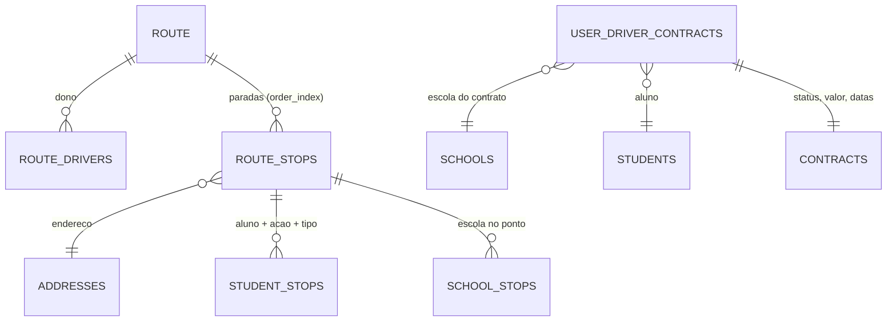

# Relatório de Auditoria — VanRoute (backend)

Branch: `routeLogic` (criada a partir de `new/useForFatecMergeExclude`, que já contém todo o `origin/develop` em `ba43ae6` + os commits de criação de escola). Escopo: **somente backend**. Nada foi commitado.

## Avisos para o time (antes de dar pull)

1. **Migrations:**
   - O antigo `V15__add_status_and_route_to_student_stops.sql` virou **V18**, porque havia dois V15. Quem já tinha aplicado esse arquivo como V15 no banco local vai ver erro de checksum no Flyway: rode `flyway repair` ou recrie o banco local.
   - **V19** apaga `student_stops.status`, `student_stops.route_id` e `student_addresses.weekdays`. Nenhum código usava essas colunas, mas os dados delas se perdem.
   - **V20** adiciona `users.photo_key`.
2. **Caminho alterado:** `POST /api/student-stop/{studentId}/{routeStopId}` virou `POST /api/route/stop/{routeStopId}/add-student/{studentId}`.
3. **Contrato de API alterado:**
   - `POST /api/route/{routeId}/stops` agora recebe `[{"address":{...}}]` (endereço no corpo; o ponto entra no fim da rota).
   - O cadastro de responsável aceita `address` (ou `addressRequestDTO`), e agora valida e exige o endereço.
   - O cadastro de aluno não tem mais `weekdays`.
4. **Chat:** `POST /api/chats/{chatId}/messages` não aceita mais `messageType` nem `payload` (o campo é ignorado, e a mensagem é sempre `REGULAR_CHAT`). As mensagens de contrato agora vêm com `messageType` na resposta, então o front deve usar esse campo para identificar proposta, aceite e recusa.
5. **Token:** o `sub` do JWT agora é o id do usuário. Quem estava logado precisa logar de novo.
6. **Migration V21:** colunas novas em `vehicles` e índice parcial em `driver_vehicles`.
7. **Variáveis novas (opcionais):** `ORS_GEOCODE_URL` e `ORS_API_KEY`, que agora tem valor padrão vazio, então o app sobe sem ela.

## H. Resumo executivo

O VanRoute é um sistema de transporte escolar que conecta **responsáveis** (pais) e **motoristas**. O backend Spring Boot cuida de cadastro e login (JWT), verificação de e-mail, alunos e seus responsáveis, convite motorista→responsável que abre um chat, proposta e aceite de contrato pelo chat (com geração de parcelas), escolas do motorista e configuração de rotas (paradas, escolas e alunos).

**Estado ao início:** a aplicação **não subia**. Havia duas migrations com versão 15, e uma consulta de contrato inválida impedia a criação do contexto. Vários fluxos centrais estavam quebrados mesmo com o código compilando:
- criar aluno não salvava o vínculo com o responsável;
- nenhuma mensagem de chat era gravada;
- o chat não abria para cerca de metade dos pares de usuários;
- o JWT não expirava.

**Estado ao final:**
- O backend sobe limpo com as 18 migrations e o schema validado.
- **Testes unitários:** 144/144 passando.
- **Testes de API ponta a ponta:** 371/371 cenários passando, nenhum retornando 500 inesperado. Inclui:
  - entrega real pelo WebSocket;
  - upload e download autorizado no MinIO (imagem e PDF de contrato).
- **Lógica de rota:** route stop com endereço (entra no fim), school stop e student stop ligados ao ponto, troca de ordem; tudo no `RouteController`.
- **O que fica pendente:** está na seção F.3.

---

## A. Visão geral

| Perfil | O que faz hoje no backend |
|---|---|
| Responsável | Cadastro com endereço (geocodificado), verificação de e-mail, cadastro de filhos, convite de outros responsáveis para o filho (código), resgate do código do motorista, chat, aceite/recusa de contrato |
| Motorista | Cadastro com CNH digital (validação de assinatura ICP-Brasil + OCR do CPF), cadastro/vínculo de escolas, chat, proposta de contrato, rotas (escolas, paradas, alunos) |
| Admin | Só existe como papel (`ROLE_ADMIN`); não há como criar admin nem endpoints de admin além de `DELETE /api/users/**` |

Funcionalidades do README como viagens, embarque em tempo real, ocorrências, pagamentos, avaliações e notificações **não estão implementadas**. Existem só as tabelas e entidades.

## B. Arquitetura

- **Java** 21 · **Spring Boot** 4.0.6 (Web MVC, Security, Data JPA, Validation, WebSocket, Data Redis, Mail, WebFlux só como cliente HTTP) · **Hibernate** 7 com `ddl-auto=validate` · **Flyway** · **PostgreSQL** 15 · **Redis** 7 · **MinIO** (AWS SDK S3 2.25) · **jjwt** 0.12.6 · **springdoc** 3.0.2 · **Tess4J** (OCR) · **BouncyCastle** + **PDFBox** (CNH).
- Camadas: `controllers` → `services` → `repositories` (Spring Data) → `models` (entidades JPA). DTOs são `record`s em `dtos/`.



- **JWT:** o `subject` é o **id do usuário** e há a claim `roles`. O filtro carrega o usuário pelo id, e `authentication.getName()` devolve o **id** (`User.getUsername()`). Controllers usam `AuthenticatedUser.id(authentication)`, e os services recebem `UUID userId` (motorista e responsável são buscados pela PK, sem JOIN por CPF). O CPF fica só no login e na checagem de cadastro duplicado. Tokens antigos (sub = CPF) recebem 401.
- **Redis:** guarda os códigos de verificação de e-mail (TTL 15 min), os códigos de vínculo de aluno (`student:link:*`) e faz o pub/sub `chat-*`, que replica as mensagens para as sessões WebSocket.
- **MinIO:** o bucket é criado no startup e é **privado**.
  - **Upload:** `GET /api/storage/presigned-url` devolve uma URL de upload (PUT, 15 min) e o `fileKey`.
  - **Download:** `GET /api/storage/download-url?fileKey=` devolve uma URL de leitura (GET, 15 min), mas **só para quem tem direito ao arquivo**:
    - quem participa do chat onde ele foi enviado como anexo;
    - quem é parte (motorista ou responsável) do contrato cujo documento é esse arquivo.

    Qualquer outro caso, inclusive arquivo inexistente, recebe 403. O front usa a URL direto em `` ou num link do PDF.
- **APIs de mapa:** `MapService.searchCoord` usa a **geocodificação Pelias** (endereço → lat/long) no cadastro de responsável, aluno e escola. `MapService.calcularRota` usa o **OpenRouteService directions (driving-car)**, mas **não é chamado em lugar nenhum**.

## C. Modelo de domínio (rotas)



- **Route** é uma *configuração* de viagem, não a execução. Ida e volta são rotas separadas, e o motorista é o dono via `route_drivers`.
- **RouteStop** é um ponto da rota: endereço + `order_index`, que define a ordem das paradas. Não guarda horário.
- **StudentStop** liga um aluno a um RouteStop, com `action` (BOARDING/ALIGHTING) e `location_type` (HOME/SCHOOL/OTHER).
- **SchoolStop** liga uma escola a um RouteStop. A escola pode ficar no meio da rota.
- **Criação devolve o contrato completo:** `POST /api/chats/{chatId}/contract` responde `{message, userDriverContractId, contract}`, onde `contract` tem os mesmos dados do GET abaixo. O payload da mensagem continua só com IDs, de propósito: uma cópia ficaria desatualizada quando o status mudasse.
- **Detalhes da proposta:** `GET /api/contract/{contractId}`, carregado numa consulta com `JOIN FETCH` (contrato, aluno, escola, endereço, motorista, responsável) mais uma para o documento, em vez de uma consulta por relação. O número de queries não foi medido em execução. devolve valor, periodicidade, datas, status, aluno, escola (com endereço), motorista, responsável e documento (`documentFileKey`, baixado via `/api/storage/download-url`). Fica no `ContractController` e não precisa do `chatId`; só as partes do contrato veem (os outros recebem 403). Criar, aceitar e recusar continuam no chat, onde a proposta nasce.
- **Contrato:** é proposto **como mensagem do chat** (`PROPOSAL`) e fica em `user_driver_contracts`, que guarda responsável, aluno, motorista, **escola** e o contrato. O aceite muda o status para `ACTIVE` e gera as parcelas (`payments`) conforme a periodicidade. A recusa muda o status para `CANCELED`.

### Fluxo de configuração da rota (motorista) — tudo no `RouteController`
Route, route stop, student stop e school stop são a **configuração** da viagem. `trips`, `boardings` e `occurrences` serão a **execução** (ainda sem código).

1. **`POST /api/route/create-route`:** cria a rota. Ida e volta são rotas diferentes.
2. **`POST /api/route/{routeId}/stops`** (método `addRouteStops`): cria os route stops com `[{"address":{street, zipCode, city, neighborhood, number, state}}]`. O endereço é geocodificado e **cada ponto novo entra no fim** (ordem = total + 1).
3. **`POST /api/route/stop/{routeStopId}/add-school/{schoolId}`:** liga a escola ao ponto. Regras: dono da rota; escola vinculada ao motorista (403); a mesma escola não pode aparecer duas vezes na rota (409).
4. **`POST /api/route/stop/{routeStopId}/add-student/{studentId}`** com `{"action":"BOARDING|ALIGHTING","locationType":"HOME|SCHOOL|OTHER","weekdays":["MONDAY",...]}`: liga o aluno ao ponto. `weekdays` é opcional e, sem ele, vale todos os dias. Regras:
   - dono da rota;
   - contrato **ACTIVE** com o aluno (403);
   - a escola do contrato precisa estar na rota (400);
   - `locationType: SCHOOL` só é aceito no ponto que tem o school stop da escola do contrato (400). Vale também ao mover;
   - **por dia**, no máximo um embarque e um desembarque do aluno na rota. Dias sobrepostos para a mesma ação retornam 409. Exemplo: embarque na esquina A seg/qua e na esquina B ter/qui, na mesma rota.

   Vários alunos podem estar no mesmo ponto.
5. **`PUT /api/route/stop/{routeStopId}/swap-order`** com `{"orderIndex":n}`: **troca** o ponto com o que está na posição *n*. Exemplo: 10 ↔ 1, e o resto não muda. Se não existe ponto na posição *n*, retorna 400.
6. **`PUT /api/route/student-stop/{studentStopId}/move`** com `{"routeStopId"}`: muda o aluno para outro ponto **da mesma rota** (outra rota → 400; para trocar de rota, exclui e cria de novo).
   **`PUT /api/route/student-stop/{studentStopId}/weekdays`** com `{"weekdays":[...]}`: troca os dias **desse** student stop (vazio = todos). Revalida a sobreposição com os outros student stops do aluno na rota, ignorando ele mesmo (409).
7. **`DELETE /api/route/student-stop/{studentStopId}`:** exclui sem regra. É configuração, e o motorista precisa excluir para refazer. Risco conhecido: pode deixar um aluno com contrato ativo sem embarque; quando houver notificações, vale avisar o responsável.
8. **`DELETE /api/route/school-stop/{schoolStopId}`:** bloqueado (409) se algum aluno da rota tem contrato ativo com aquela escola.
9. **`DELETE /api/route/stop/{routeStopId}`:** só exclui ponto vazio, sem alunos nem escolas (409). Os pontos de baixo sobem uma posição, para a ordem continuar 1..n.

**Pendências:** `GET /api/route/{routeId}/pending` devolve, por aluno da rota, os dias em que ele aparece mas falta embarque (`missingBoarding`) ou desembarque (`missingAlighting`). Exemplo testado: embarque todos os dias e desembarques seg/qua + ter/qui dão `missingAlighting = [FRIDAY, SATURDAY, SUNDAY]`. `A trip, quando existir, deve usar essas pendências para recusar o início de uma rota sem alunos ou incompleta.

**Na trip de um dia:** percorrem-se os route stops pela ordem e, em cada um, pegam-se os student stops que contêm aquele dia. Um ponto sem aluno naquele dia é pulado. Falta e presença ficam no boarding.

**Responsável:** `GET /api/student/{studentId}/routes` devolve só `id` e `name` das rotas em que o filho está, sem pontos, ordem ou endereços. Acesso: qualquer responsável vinculado ao aluno.

**Falta num dia:** é assunto da execução (trip/boarding). O aluno sai daquela trip e a configuração não muda.

**Consultas:** `GET /api/route/{routeId}/stops` lista os pontos de uma rota, em ordem. `GET /api/route/get-all-routes-and-stops` lista todas as rotas do motorista com os pontos. Cada ponto vem com endereço, `students` (id do student stop, aluno, ação, tipo, dias) e `schools` (id do school stop, escola); são esses IDs que o front usa para mover e excluir.

Os endpoints antigos `POST /api/student-stop/{studentId}/{routeStopId}` (`StudentStopController`) e o `SchoolStopController` foram **unificados no `RouteController`** (caminhos acima). Os services `StudentStopService` e `SchoolStopService` continuam.

**Dias da semana (migration V19):**
- `student_stops.weekdays` guarda os dias em que o aluno usa aquele ponto, como texto `MONDAY,WEDNESDAY` convertido para `Set<WeekDay>` por um `AttributeConverter` (padrão JPA). Registros antigos valem todos os dias.
- Trade-off: o banco só enxerga texto. A checagem de sobreposição roda em Java, sobre 1 ou 2 linhas. Quando a execução (trips) precisar filtrar "alunos de segunda" em SQL, vai ser `LIKE '%MONDAY%'`, sem índice. Se isso pesar, trocar por `text[]` com índice GIN ou por bitmask `int`.
- Removidos `student_stops.status` e `student_stops.route_id`, da V18: nunca usados, e a rota já vem pelo ponto.
- Removido `student_addresses.weekdays`, a tentativa anterior de dias por endereço, sem uso em regra nenhuma. O campo `weekdays` saiu do cadastro e da resposta de aluno; o mapper ainda devolvia a rua no lugar dele.

**Onde fica o endereço:** no route stop, que é o lugar onde a van para. Não mudou o banco. Assim a regra "alunos com endereços diferentes não podem estar no mesmo ponto" vale automaticamente: o ponto tem um endereço só. Tirar o endereço do ponto e colocar no student stop e no school stop exigiria duplicar o endereço e validar a consistência a cada vínculo. Dois alunos no mesmo ponto com casas diferentes é válido; a casa de cada um está em `student_addresses`. Pelo mesmo motivo, não se exige que o endereço do ponto seja igual ao da escola, porque o portão pode estar em outra rua.

### Foto de perfil (migration V20)
- `users.photo_key` guarda a **chave** do arquivo no MinIO, não a URL, porque a URL assinada expira. O `GET /api/users/{id}` e a lista de chats (`otherUserPhotoKey`) devolvem a chave, e o front pega a URL em `/api/storage/download-url`.
- **Fluxo:**
  1. `GET /api/users/photo-upload-url?fileName&contentType`: só `image/*`; a chave é `profile/{userId}/...`.
  2. Upload direto no MinIO.
  3. `PUT /api/users/update-photo {fileKey}`.
- **Quem vê:** qualquer usuário logado baixa arquivos em `profile/`. O resto do bucket continua restrito.
- **Proteção:** o `update-photo` só aceita chave da pasta do próprio usuário e que exista no bucket. Assim ninguém transforma um anexo privado em foto pública. A foto antiga é apagada do bucket na troca.

### Migrations
V21 (`V21__vehicle_data_from_crlv.sql`): dados do CRLV em `vehicles` e vínculo motorista↔van único só enquanto ativo.
V20 (`V20__add_photo_to_users.sql`): adiciona `users.photo_key`.
V19 (`V19__weekdays_on_student_stops.sql`): adiciona `student_stops.weekdays` e remove `student_stops.status`, `student_stops.route_id` e `student_addresses.weekdays`.

V1–V17 originais. O antigo `V15__add_status_and_route_to_student_stops.sql` virou **V18** e ficou idempotente, porque havia dois V15. A entidade `StudentStop` não mapeia essas colunas (`status`, `route_id`).

## D. API

Legenda: ✅ coberto pelo script de API · 🧪 coberto só por teste unitário · ⚠️ coberto parcialmente · ❌ não testado.

| Grupo | Método e caminho | Auth | Teste |
|---|---|---|---|
| Auth | POST `/api/auth/login` | pública | ✅ |
| | POST `/api/auth/verify-email` | pública | ✅ |
| | POST `/api/auth/send-verification-code?email=` | pública | ✅ |
| Responsável | POST `/api/responsible/auth/signup` | pública | ✅ |
| Motorista | POST `/api/driver/auth/signup` (multipart) | pública | ⚠️ só os negativos; o positivo exige CNH digital real |
| | POST `/api/driver/auth/verify-CNH` | pública | ⚠️ só o negativo |
| Escola | POST `/api/school/add-school` | motorista | ✅ |
| | GET `/api/school/my-schools` **(novo)**: id, nome, telefone, e-mail e endereço | motorista | ✅ |
| Aluno | POST `/api/student/create-student` | responsável | ✅ |
| | POST `/api/student/generate-link` | responsável admin do aluno | ✅ |
| | POST `/api/student/confirm-link` | responsável | ✅ |
| | GET `/api/student/my-children` (filtros + paginação) | responsável | ✅ |
| Convite | POST `/api/invite-code/redeem` | responsável | ✅ |
| Chat | GET `/api/chats` | logado | ✅ |
| | GET / POST `/api/chats/{chatId}/messages` | participante | ✅ |
| | POST `/api/chats/{chatId}/contract` | motorista participante | ✅ |
| | PUT `/api/chats/{chatId}/contracts/{contractId}/accept` · `/reject` | responsável do contrato | ✅ |
| Contrato | GET `/api/contract/{contractId}` **(novo, `ContractController`)** | parte do contrato | ✅ |
| | GET `/api/contract/my-contracts` **(novo)** | motorista ou responsável | ✅ |
| | GET `/api/chats/{chatId}/students` **(novo)** | motorista do chat | ✅ |
| Usuário | GET `/api/users/me` **(novo)** | logado | ✅ |
| Van | POST `/api/vehicle/add-vehicle` · GET `/my-vehicles` · PUT `/{vehicleId}/unlink` **(novos)** | motorista | ✅ (com CRLV digital real; validação ICP-Brasil + leitura dos dados pelo texto do PDF) |
| | WS `/chat/{chatId}?token=` | participante | ✅ (handshake 101/401, entrega em tempo real via Redis, usuário de fora desconectado com 1003) |
| Rota | POST `/api/route/create-route` | motorista | ✅ |
| | POST `/api/route/{routeId}/stops` (`addRouteStops`, corpo com endereço) | dono da rota | ✅ |
| | PUT `/api/route/stop/{routeStopId}/swap-order` **(novo, troca)** | dono da rota | ✅ |
| | POST `/api/route/stop/{routeStopId}/add-school/{schoolId}` **(novo)** | dono da rota + escola do motorista | ✅ |
| | POST `/api/route/stop/{routeStopId}/add-student/{studentId}` (era `/api/student-stop/...`) | dono da rota + contrato ativo | ✅ |
| | PUT `/api/route/student-stop/{studentStopId}/move` · `/weekdays` **(novos)** | dono da rota | ✅ |
| Aluno | GET `/api/student/{studentId}/routes` **(novo)** | responsável do aluno | ✅ |
| | GET `/api/route/{routeId}/pending` **(novo)** | dono da rota | ✅ |
| | DELETE `/api/route/student-stop/{id}` · `/school-stop/{id}` · `/stop/{id}` **(novos)** | dono da rota | ✅ |
| | GET `/api/route/{id}` · `/{routeId}/stops` · `/get-all-routes-and-stops` | dono da rota | ✅ |
| Storage | GET `/api/storage/presigned-url` | logado | ✅ (upload real de imagem e PDF) |
| | GET `/api/storage/download-url?fileKey=` **(novo)** | participante do chat / parte do contrato | ✅ (conteúdo baixado idêntico ao enviado; 403 para quem está de fora, para arquivo inexistente e para assinatura adulterada) |
| Usuário | GET `/api/users/{id}` | logado | ✅ |
| | POST `/api/users/send-code-updateUser` · PUT `/api/users/update-user` | logado | ✅ |
| | GET `/api/users/photo-upload-url` · PUT `/api/users/update-photo` **(novos)** | logado | ✅ |
| | DELETE `/api/users/{id}/{code}` | ADMIN | ⚠️ só o 403 (não existe admin) |
| Infra | GET `/v3/api-docs`, `/swagger-ui.html` | pública | ✅ |

Total: **51 endpoints REST + 1 WebSocket**.
- 48 REST e o WebSocket testados no fluxo (✅).
- 3 REST testados parcialmente (⚠️): cadastro e verify-CNH do motorista, e delete de usuário.

**Ordem de dependência usada nos testes:**
1. Cadastro do responsável → código de e-mail (Redis) → verificação → login.
2. Motoristas → escola (e vínculo de outro motorista à mesma escola).
3. Aluno → código de vínculo → segundo responsável.
4. Convite do motorista → chat → mensagens.
5. Proposta de contrato → aceite (parcelas) e recusa.
6. Rota → route stops (endereço; entram no fim) → school stop → student stop (embarque e desembarque; dois irmãos no mesmo ponto) → troca de ordem → mover aluno de ponto → exclusões (com bloqueios).
7. Storage, com os arquivos reais `images.jpeg` e `teste.pdf` da raiz do repositório (conteúdo baixado conferido por sha256): upload → anexo no chat → download autorizado; PDF → contrato → download pelas partes.
8. Usuário.

> O caminho completo de criação de pontos é **`POST /api/route/{routeId}/stops`** (plural, com `/api`); no código o método se chama `RouteController.addRouteStops`.

**Padrão de nomes:** os endpoints criados nesta auditoria seguem o padrão do projeto: recurso no singular no prefixo (`/api/route`, `/api/contract`) e ações em kebab-case (`add-student`, `swap-order`, `my-schools`). Os endpoints que já existiam não foram renomeados.

## E. Execução

```bash
docker compose up -d db redis minio        # Postgres 5432, Redis 6379, MinIO 9000/9001
cd backend && ./mvnw clean package          # compila + testes unitários
java -jar target/backend-0.0.1-SNAPSHOT.jar # API em :9090
```

**Variáveis de ambiente** (todas têm default, exceto as de e-mail):
- banco: `DATABASE_HOST/PORT/NAME/USERNAME/PASSWORD`;
- `REDIS_HOST/PORT`;
- MinIO: `MINIO_ENDPOINT/ACCESS_KEY/SECRET_KEY/BUCKET_NAME`;
- JWT: `JWT_KEY`, `JWT_EXPIRATION` (ms);
- geocodificação: `ORS_API_KEY` e `ORS_GEOCODE_URL` (nova, padrão `https://api.heigit.org/pelias/v1/search`);
- e-mail: `spring.mail.*` (o profile `local` lê o `application-local.properties`, ignorado pelo git).

### Testes de API (reproduzível, sem serviços externos)
```bash
docker exec vanroute-db psql -U postgres -c 'CREATE DATABASE vanroute_audit'   # base isolada (1x)
python3 -I backend/api-tests/stubs.py &    # SMTP fake :2525 e geocoder fake :8089
cd backend && DATABASE_NAME=vanroute_audit MINIO_BUCKET_NAME=vanroute-audit \
  SPRING_MAIL_HOST=127.0.0.1 SPRING_MAIL_PORT=2525 SPRING_MAIL_USERNAME=stub SPRING_MAIL_PASSWORD=stub \
  SPRING_MAIL_PROPERTIES_MAIL_SMTP_STARTTLS_ENABLE=false \
  ORS_GEOCODE_URL=http://127.0.0.1:8089/pelias/v1/search java -jar target/backend-0.0.1-SNAPSHOT.jar &
./api-tests/run-api-tests.sh   # usa node >= 22 para o teste de WebSocket (api-tests/ws-test.mjs)
```

**Tipos de teste:**
- **Unitários** (`mvn test`, Mockito) testam a classe isolada, com banco e Redis falsos.
- O **script** é um teste de integração ponta a ponta: HTTP real contra banco, Redis e MinIO reais. Foi ele que achou os bugs que os unitários não pegam: coluna `jsonb`, query derivada inválida, ordenação de UUID e serialização para o WebSocket.
- A alternativa mais "padrão Spring" seria `@SpringBootTest` + MockMvc/RestAssured + Testcontainers, rodando no `mvn test`.

- **Dados de teste:** cada execução gera dados fictícios novos (CPFs válidos aleatórios), então o script pode ser repetido.
- **Motoristas:** são inseridos via SQL **só na base de auditoria**. O cadastro real exige uma CNH digital assinada ICP-Brasil, que não dá para gerar com dados fictícios.
- **Testes unitários:** o `BackendApplicationTests` sobe o contexto completo e roda o Flyway. Use uma base separada: `DATABASE_NAME=vanroute_test ./mvnw test`.

## F. Resultados

### F.1 Números (execução real)
| Suite | Antes | Depois |
|---|---|---|
| Testes unitários/integração (Maven) | 72: 65 ok, 3 falhas, 4 erros (contexto não subia) | **144: 144 ok** |
| Cenários de API (`run-api-tests.sh` + `ws-test.mjs`) | não executável (app não subia) | **371: 371 ok**, nenhum 500 e nenhum `ERROR` no log do servidor |

**Novos testes unitários:**
- `TokenProviderTest` (2);
- `StudentStopServiceTest` (9, inclui dias da semana), `SchoolStopServiceTest` (5) e `RouteServiceTest` (5: troca, criação no fim, exclusão);
- `JacksonConfigTest` (1);
- `StorageServiceTest` (+3, download autorizado/negado);
- `DriverSchoolServiceTest` (2);
- `ChatServiceTest` (+1, ordenação de UUID);
- `StudentServiceTest` (2 reativados e adaptados: o teste antigo comentado já exigia salvar o vínculo).

**Testes antigos atualizados** (desatualizados em relação ao código):
- `ContractServiceTest` e `ResponsibleServiceTest`: faltavam mocks de dependências novas;
- `UserControllerTest`: a verificação "exatamente 1 chamada" quebrava porque o próprio Spring chama `getName()`;
- `ResponsibleControllerTest`: usava um CPF inválido, um mock inconsistente, e o envio de e-mail agora acontece no service.

### F.2 Problemas encontrados e corrigidos
| # | Problema | Causa | Correção |
|---|---|---|---|
| 1 | App não subia | dois `V15__*.sql` | o segundo virou `V18`, idempotente |
| 2 | App não subia | `existsByDriverIdAndStudent...` (o PK de `Driver` é `userId`) | renomeado para `existsByDriverUserId...` |
| 3 | App não subia sem `ORS_API_KEY` | placeholder sem default | `${ORS_API_KEY:}` |
| 4 | JWT nunca expirava | `issuedAt(expiration)` e nenhum `exp` | `issuedAt(now).expiration(...)` |
| 5 | Aluno criado sem vínculo com o responsável; `my-children` vazio; impossível gerar código | o `save` do `StudentResponsible` foi removido no commit `64e1cd7` | `save` restaurado + `@Transactional` (também persiste as coordenadas) |
| 6 | Nenhuma mensagem de chat (nem proposta de contrato) era gravada | `payload` String numa coluna `jsonb` sem tipo JSON | `@JdbcTypeCode(SqlTypes.JSON)` |
| 7 | Chat não era criado para cerca de 50% dos pares (409) | `UUID.compareTo` (long com sinal) ≠ ordem do Postgres no `CHECK (user_one_id < user_two_id)` | comparação pela string do UUID |
| 8 | Motorista via e alterava as rotas de outros motoristas | sem checagem de dono; `findAll` listava tudo | `checkOwnership` via `route_drivers` |
| 9 | Escola já existente → erro em vez de vincular o motorista; checava nome e rua separadamente | lógica do `DriverSchoolService` | busca por nome + rua; vincula; 409 se já vinculado |
| 10 | Route stop com `studentAddressId` nunca era encontrado (buscava em `addresses` com o ID de `student_addresses`) | desenho do DTO | o route stop agora recebe o endereço no corpo |
| 11 | Campo `state` das paradas mostrava a rua | parâmetro trocado | `getState()` |
| 12 | Cadastro de responsável sem validação (CPF, senha, confirmação, endereço) e sem envio do código | sem `@Valid`; o envio sumiu num merge | `@Valid`, `@PasswordMatch`, `@NotNull` no endereço (aceita `address` ou `addressRequestDTO`); envio dentro da transação |
| 13 | `passwordHash` (bcrypt) exposto em `GET /api/users/{id}` | entidade serializada direto | `@JsonIgnore` |
| 14 | Tudo virava 500 (JSON inválido, 401, 404, conflito…) | handler `Exception.class` genérico; `BadRequestException` importada do Tomcat no login | handlers por tipo + import correto; `RuntimeException`s de "não encontrado/sem permissão" trocadas por exceções específicas nos services de escola, aluno, vínculo, convite, rota e contrato (sem mudar regra) |
| 16 | **WebSocket nunca entregava mensagens** (nem as de contrato) | o `ObjectMapper` do `JacksonConfig` não tinha o `JavaTimeModule`; `LocalDateTime` quebrava o `writeValueAsString` e o erro era engolido pelo `catch` | `JavaTimeModule` registrado + datas em ISO |
| 17 | Front não conseguia exibir imagens nem documentos enviados (só existia URL de upload) | faltava leitura | `GET /api/storage/download-url` com URL assinada e checagem de permissão; bucket continua privado |
| 18 | Qualquer participante podia forjar mensagem de contrato (PROPOSAL/APPROVAL/REJECTION com payload) pelo endpoint de mensagens; a resposta não informava o tipo | `messageType` e `payload` no DTO público (commit 9dc00d3) | DTO público só com conteúdo e anexo, mensagem do usuário sempre `REGULAR_CHAT`; as do contrato saem por `ChatMessageService.sendSystemMessage`; a resposta inclui `messageType` |
| 19 | Dados pedidos pela API mas nunca entregues: o motorista não via o próprio código de convite; ninguém sabia o próprio `userId` (o token só tem o CPF); o motorista não tinha como obter o `studentId` para a proposta nem a lista de alunos com contrato ativo para a rota | faltavam endpoints de leitura | `GET /api/users/me` (inclui `linkCode` para motorista), `GET /api/chats/{chatId}/students` (só o motorista do chat), `GET /api/contract/my-contracts`, e `studentName` nos student stops. O script de API passou a obter todos os IDs pela própria API, sem consultar o banco |
| 20 | Identidade por CPF: cada requisição buscava o usuário/motorista/responsável pelo CPF; código de atualização de usuário numa chave Redis única (um usuário usava o código do outro) | token e serviços desenhados sobre o CPF | `sub` do token e `authentication.getName()` = id; services recebem `UUID`; chave do código por usuário |
| 15 | Endereço não geocodificável → NPE/500 | sem checar lista vazia | 400 "Endereço não encontrado"; URL do geocoder configurável |

### F.3 Pendências e limitações (não corrigidas)
- **Não verificado:**
  - cadastro de motorista com CNH real (OCR + ICP-Brasil);
  - envio real pelo Gmail;
  - geocodificação real (sem `ORS_API_KEY`);
  - worker Go;
  - frontend (fora do escopo).
- **`GET /api/users/{id}`:** qualquer usuário logado lê CPF, e-mail e telefone de qualquer outro.
- **Anexos com `fileKey` alheio:** o acesso ao download vem de "o arquivo estar numa mensagem do meu chat". Se alguém souber o `fileKey` de outra pessoa (um UUID aleatório, impraticável de adivinhar) e mandá-lo como anexo no próprio chat, ganharia acesso. Para fechar de vez, seria preciso registrar o dono no upload.
- **Viagens e ocorrências:** `trips`, `boardings` e `occurrences` existem só como tabela, sem código.
- **Mensagem de proposta:** o payload leva só IDs, mas os detalhes agora vêm de `GET /api/contract/{contractId}` (o `contractId` está no payload): `GET /api/contract/{contractId}`.
- **Verificação de e-mail:**
  - o endpoint não usa `@Valid`, e `VerifyEmailRequestDTO` tem `@Size(min = 8)` para um código de 6 dígitos;
  - o código usa `java.util.Random` e não tem limite de tentativas.
- **Exceções genéricas:** ainda há `RuntimeException` (→ 500) em `ChatService` e `StudentStopService`, entre outros.
- **Configuração:**
  - `JWT_KEY` e as senhas de banco e MinIO têm default no `application.yml`;
  - o CORS usa `allowedOriginPatterns("**")` com credentials, e o WebSocket `setAllowedOrigins("*")`;
  - o e-mail remetente está fixo no `application.properties`.
- **Worker Go:** apaga `users` com status `CHECK_EMAIL`, mas `responsible_addresses` não tem `ON DELETE CASCADE`. Provavelmente falha para responsáveis (não testado).
- **Bancos que já aplicaram o antigo `V15__add_status...`:** vão acusar divergência de checksum no V15. Nesse caso é preciso `flyway repair` ou ajuste manual. O banco local `vanroute_db` aplicou o outro V15 e não tem esse problema.
- **`UserRepository`:** tem um método estranho, `Optional<UUID> findByCpf(UUID)`, que não é usado.

## G. Segurança e qualidade — verificado
- **Rejeitam acesso:**
  - rota protegida sem token ou com token inválido (401);
  - JWT com `exp` (unitário + script);
  - login antes da verificação de e-mail;
  - senha errada;
  - CPF inválido;
  - senha fraca ou diferente da confirmação;
  - JSON malformado.
- **Isolamento:**
  - chat de outro usuário;
  - rota de outro motorista;
  - aluno sem contrato ativo;
  - escola não vinculada;
  - responsável não-admin gerando código;
  - aceite de contrato por quem não é o responsável;
  - aceite duplicado;
  - contrato duplicado.
- **Persistência conferida no banco:**
  - vínculos;
  - coordenadas;
  - status do contrato;
  - 5 parcelas mensais (fev–jun);
  - `school_stops`;
  - objeto no MinIO.

## Arquivos alterados/criados
- **Main:**
  - `config/TokenProvider`, `config/JacksonConfig`, `models/user/User`, `models/chat/ChatMessage`;
  - controllers: `ResponsibleController`, `RouteController`, `StorageController`; `StudentStopController` **removido** (unificado no `RouteController`);
  - DTOs: `dtos/user/ResponsibleRequestDTO`, `dtos/route/AddRouteStopRequest`, `dtos/route/UpdateRouteStopOrderRequest` (novo), `dtos/route/stops/StudentStopRequestDTO`, `dtos/route/stops/SchoolStopResponseDTO` (novo), `dtos/route/stops/MoveStudentStopRequestDTO` (novo);
  - `exceptions/handler/CustomEntityResponseHandler`;
  - repositories: `ChatMessage`, `Document`, `RouteDriver`, `School`, `SchoolStop`, `StudentStop`, `UserDriverContract`;
  - services: `Authentication`, `Chat`, `Contract`, `DriverSchool`, `InviteCode`, `Map`, `Responsible`, `Route`, `SchoolStop`, `StudentStop`, `Storage`, `Student`, `StudentLink`;
  - `application.properties`;
  - migration `V15__add_status...` → `V18__add_status...`.
- **Test:**
  - `config/TokenProviderTest`, `config/JacksonConfigTest`, `services/StudentStopServiceTest`, `services/SchoolStopServiceTest`, `services/DriverSchoolServiceTest` (novos);
  - ajustes em `StorageServiceTest`, `ChatServiceTest`, `ContractServiceTest`, `ResponsibleServiceTest`, `StudentServiceTest`, `AuthenticationServiceTest`, `ResponsibleControllerTest`, `UserControllerTest`.
- **Ferramentas:** `backend/api-tests/run-api-tests.sh`, `backend/api-tests/ws-test.mjs` e `backend/api-tests/stubs.py` (a saída vai para `api-tests/out/`).
